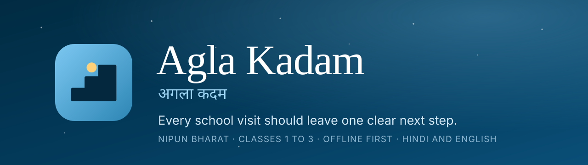
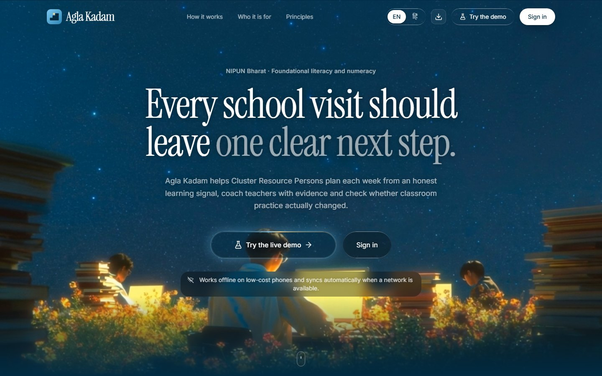
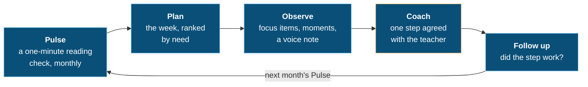
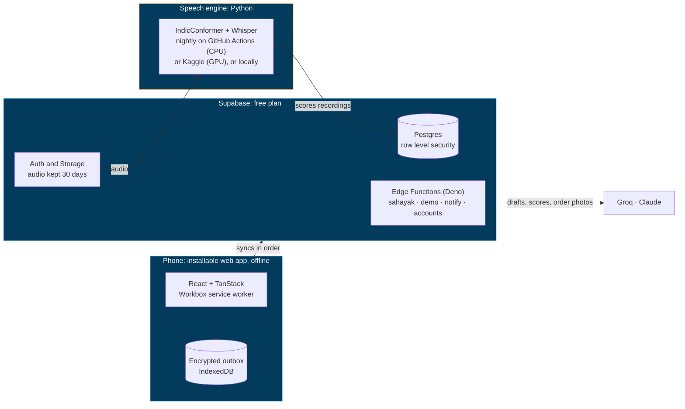

<div align="center">



<br>

[](https://agla-kadam-pi.vercel.app)
[](https://github.com/abhaykn/AglaKadam/actions/workflows/ci.yml)
[](LICENSE)


**[Live app](https://agla-kadam-pi.vercel.app)** &nbsp;·&nbsp;
**[Try the demo](https://agla-kadam-pi.vercel.app/demo)** &nbsp;·&nbsp;
**[The loop](#the-loop)** &nbsp;·&nbsp;
**[AI services](#ai-services-and-models)** &nbsp;·&nbsp;
**[Architecture](#architecture)** &nbsp;·&nbsp;
**[Run it locally](#run-it-locally)**

</div>

---

Agla Kadam helps Cluster Resource Persons (CRPs) turn routine school visits into measured
improvement in how children learn to read. It plans the CRP's week from an honest learning signal,
prepares each visit, turns what the CRP observes into one clear next step for the teacher, and
checks at the next visit and in the next month's reading check whether the step worked.

It is an installable web app for low-cost Android phones. It works offline on 2G and is built
around NIPUN Bharat's goals for Classes 1 to 3, in Hindi and English.

<p align="center">
  <a href="https://agla-kadam-pi.vercel.app"></a>
</p>

## Highlights

| | |
| --- | --- |
| **One clear next step** | Every visit ends with one strength, one practice and a check-back date, agreed with the teacher, and the next visit and the next month's reading check show whether it worked. |
| **Works offline** | Attendance, reading checks, visits, coaching, marks and notes are all kept encrypted on the phone and sent in order when a network returns. |
| **Hindi and English** | The whole interface is in both languages, and a reading check is taken in the class's own language. |
| **Speech scoring with open models** | Children's recordings never leave our own engine: IndicConformer and Whisper score reading and spoken English. |
| **Evidence, not rankings** | Offices see totals over at least five classes and three schools, and every report says how much of it was independently confirmed. |
| **Private by design** | Audio only, guardian consent before any recording, row level security on every table, recordings deleted after 30 days. |

## Try it

Open the live app and choose **Try the demo**. Pick a role (teacher, CRP, block education officer
or family) and the app builds a complete simulated district for you in about 20 seconds: 16
schools, about 1,200 children and three months of attendance, reading checks, visits, exams and
notes. No account or password is needed. Each visitor gets their own district, kept for three
days. A banner switches between roles, and a short guide lists what to try in each one.

Everything in a demonstration district is simulated, and it is kept apart from real data.

## Who uses it

| Role | What they do in the app |
| --- | --- |
| **Teacher** | Takes attendance, records the week's Pulse children, enters exam marks, shares results and notes with families. |
| **Cluster Resource Person** | Plans the week, prepares and runs visits, agrees one step with each teacher, drafts and scores feedback with Sahayak, rehearses hard conversations. |
| **Block education officer** | Sees totals over many classes and schools: never rankings of a person or a class. |
| **Family** | Sees the child's attendance, shared results and the teacher's notes, and practises reading and numbers at home. |

## The loop



| Step | What happens | Where AI helps |
| --- | --- | --- |
| **Pulse** | Each month the app draws 20 children per class at random and opens five a week. The teacher records a one-minute check in the app: the child reads a short text in the class language, then speaks English about pictures. | Speech recognition scores reading accuracy, words a minute and spoken English. |
| **Plan** | The CRP's week is ranked by need: check-backs due, children needing support, teachers' requests, time since the last visit. Block orders become tasks. | A vision model reads a photo of an order into tasks the CRP checks. |
| **Observe** | Five focus items, moments tapped during the lesson, and a two-minute voice note. The CRP re-checks two children. | The voice note is transcribed overnight. |
| **Coach** | One strength backed by evidence, one practice from a library with a ten-minute demonstration, a two-week plan and a check-back date, agreed with the teacher. | A language model drafts the feedback from the evidence; the CRP edits it. A private score shows the CRP how specific and actionable it was. A rehearsal room lets the CRP practise a hard conversation with a simulated teacher. |
| **Follow up** | The next visit checks whether the step is in use, and the next month's Pulse shows whether reading moved. Offices see only totals over many classes. | |

Teachers also take attendance, enter school exam marks (compared with Pulse to spot marks that
the reading checks do not bear out) and send notes and homework to families. Families see their
child's attendance, shared results and teachers' notes, and practise reading at home.

## AI services and models

Every external AI service the product calls, what it does and the keys it needs:

| Service / model | Used for | Called from | Keys and settings |
| --- | --- | --- | --- |
| [IndicConformer 600M multilingual](https://huggingface.co/ai4bharat/indic-conformer-600m-multilingual) (AI4Bharat), open model run by our engine | Transcribing Hindi reading in Pulse checks and voice notes | `engine/` (nightly on GitHub Actions, on Kaggle's GPU, or on any computer) | `HF_TOKEN` of a Hugging Face account that accepted the model's terms (gated model) |
| [Whisper small](https://huggingface.co/Systran/faster-whisper-small) (faster-whisper), open model run by our engine | Transcribing spoken English in Pulse checks; Hindi when IndicConformer is not available | `engine/` | none |
| Groq API: `openai/gpt-oss-120b` | Feedback drafts; the judged parts of the feedback score | `supabase/functions/sahayak` | `GROQ_API_KEY` (Edge Function secret) |
| Groq API: `qwen/qwen3.8-27b` (vision) | Reading a photo of a block order into tasks | `supabase/functions/sahayak` | `GROQ_API_KEY` |
| Groq API: `llama-3.3-70b-versatile` | The rehearsal room when Claude is not available | `supabase/functions/sahayak` | `GROQ_API_KEY` |
| Anthropic Claude API: `claude-sonnet-5-5` | The rehearsal room's simulated teacher and the debrief after it | `supabase/functions/sahayak` | `ANTHROPIC_API_KEY` (optional; falls back to Groq) |
| The phone's own speech synthesis | Reading words and stories aloud in the family's practice | the browser | none |

Models can be changed with the secrets `GROQ_TEXT_MODEL`, `GROQ_VISION_MODEL`, `GROQ_CHAT_MODEL`
and `CLAUDE_MODEL`. Children's recordings are never sent to a third-party AI service: speech is
recognised by the open models in our own engine.

### Guardrails

- **Scoring:** a score the engine is unsure of (low confidence, noise, no speech), or one that
  disagrees with the teacher's own levels, is held for the CRP to listen to; the CRP's levels then
  count instead. Reading speed in offices' reports uses only scores the engine is sure of, and every
  report says what share of levels were independently confirmed.
- **Drafts:** children's and teachers' names are taken out on the phone and again on the server
  before any text is sent; answers must match a strict JSON schema; evidence must cite moments and
  items of this visit, and a practice must come from the library. Nothing reaches the teacher
  until the CRP has edited and agreed it.
- **Order photos:** every task is shown to the CRP to check, edit or drop before it is added.
- **Allowances:** daily limits per person and per project, smaller ones for demonstration visitors,
  and a request that generated nothing is given back.

## Works offline

| Works without a network | Needs a network |
| --- | --- |
| Attendance, Pulse recording (a week that opened offline is unlocked by the CRP's QR code), visits with focus items, moments and voice notes, coaching and agreement, exam marks, notes to families, consent records, home practice | Signing in on a new phone, Sahayak (drafts, scores, order photos, rehearsal), listening to a recording for the first time, opening a demonstration district |

Changes made offline are kept encrypted on the phone (IndexedDB, AES-GCM, a key per account) and
sent in order when a network returns, also by the service worker after the app is closed. A
recording is about 120 KB.

## Architecture



| Layer | Built with |
| --- | --- |
| Web app | React 19, TypeScript, Vite, Tailwind CSS 4, TanStack Router and Query, Workbox, i18next |
| Data | Supabase: Postgres with row level security, Auth, Storage, Edge Functions (Deno) |
| Speech engine | Python, IndicConformer, faster-whisper |
| Hosting and automation | Vercel, GitHub Actions, optionally Kaggle |

## Repository

```text
apps/web/                 The web app (React 19, TypeScript, Vite, Tailwind CSS 4, TanStack)
supabase/migrations/      Database schema, row level security and scheduled jobs (plain SQL)
supabase/functions/       Edge Functions (Deno), with shared modules in _shared/
engine/                   Speech scoring engine (Python), and a Kaggle notebook in engine/kaggle/
packages/database/        Schema and access-policy tests on an in-process PostgreSQL (PGlite)
packages/edge-functions/  Edge Function tests, lint and type-check
packages/live-check/      End-to-end check against a hosted project, and key-setting helpers
.github/workflows/        CI, nightly scoring, and a keep-alive for the free database
```

## Run it locally

Requirements: Node.js 22.12 or newer (24 recommended, see `.nvmrc`) and npm 10.9 or newer.

```bash
npm install
cp apps/web/.env.example apps/web/.env.local   # fill in the Supabase URL and publishable key
npm run dev                                     # http://localhost:5173
```

The web app needs a Supabase project. To set one up:

```bash
npx supabase login
npx supabase link --project-ref <project-ref>
npx supabase db push                            # applies supabase/migrations
npx supabase functions deploy --use-api         # deploys every Edge Function
npm run ai:keys                                 # stores the Groq and Claude keys as secrets
npm run push:keys                               # creates and stores the Web Push keys
npx supabase secrets set DEMO_ENABLED=true      # optional: demonstration districts
```

`supabase/functions/.env.example` lists every Edge Function secret. For scheduled jobs (nightly
draw, push notifications, removal of old audio and expired demonstrations), add the project's URL
to Vault as `project_url`.

To score recordings, set up the engine (Python 3.11 to 3.13):

```bash
cd engine
python -m venv .venv && . .venv/bin/activate    # on Windows: .venv\Scripts\activate
pip install torch==2.14.1 --index-url https://download.pytorch.org/whl/cpu   # CPU-only machines
pip install -e ".[speech]" -c constraints.txt
agla-engine download-models                     # once; needs HF_TOKEN for IndicConformer
agla-engine score                               # reads SUPABASE_URL and SUPABASE_SECRET_KEY
```

`engine/.env.example` lists its settings. The nightly workflow
(`.github/workflows/pulse-scoring.yml`) uses the repository secrets `SUPABASE_URL`,
`SUPABASE_SECRET_KEY` and `HF_TOKEN`; `engine/kaggle/pulse-scoring.ipynb` runs the same engine on
Kaggle's GPU.

## Tests

```bash
npm run verify        # formatting, lint, type-check, all tests and the production build
npm run check:live    # end-to-end check of a hosted project (asks for its secret key; leaves nothing behind)
cd engine && pytest   # the speech engine
```

The suites cover the web app, every database policy and role, the Edge Functions and the engine:
about 360 database tests, 365 web tests, 137 Edge Function tests and 25 live-check tests, run on every push.
`check:live` signs in as each role on the hosted project and runs the whole loop, from importing a
school to Pulse, a visit, exams, Sahayak and the demonstration, then removes everything it made.

## Deployment

The web app is a static site. `vercel.json` builds it with `npm run build`, serves every app page
from `index.html` (while missing code files answer 404, so a page left open across a release offers
a reload), never caches the service worker, and sets a strict Content Security Policy. Set the
`VITE_` variables of `apps/web/.env.example` in the host's environment, with
`VITE_APP_ENV=production`.

## Privacy

Audio only: no faces or biometrics are recorded. Recordings are deleted after 30 days, and voice
notes with them. Every table has row level security; a teacher sees their own classes, a CRP their
cluster, and an office only totals over at least five classes and three schools, never rankings.
Recording a child needs a guardian's recorded consent, and a withdrawal takes effect at once.

## Licence

Released under the [MIT Licence](LICENSE).
